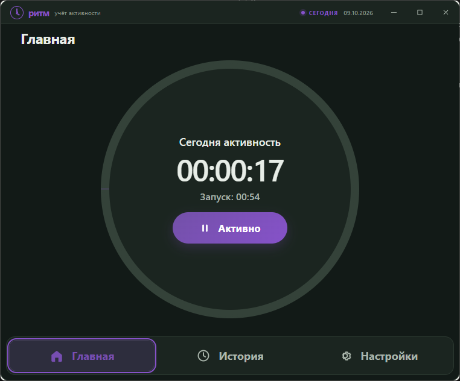
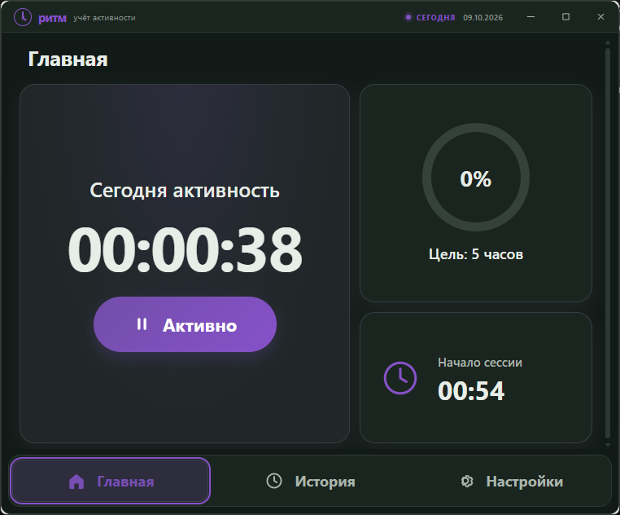
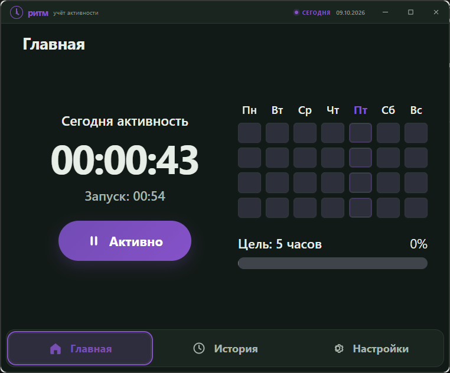
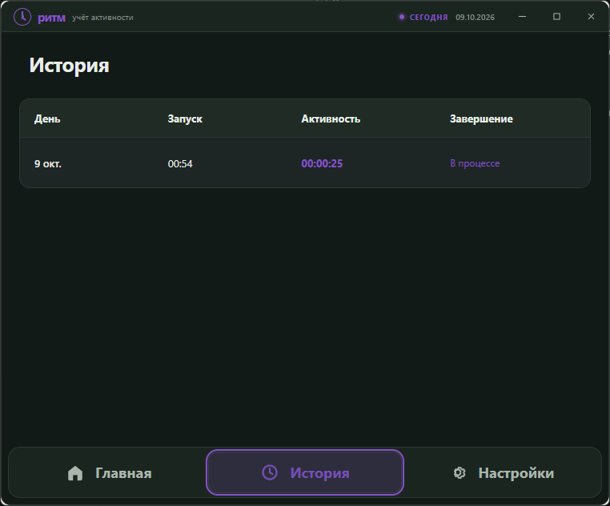
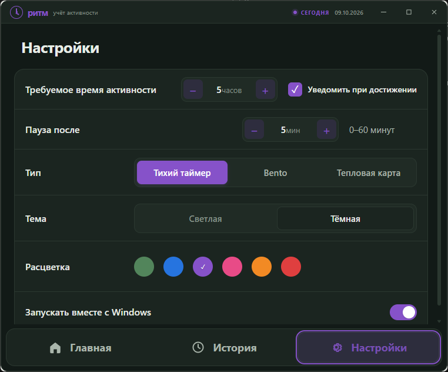

# Ритм

<div align="center">
  <p><strong>Локальный учёт активности за компьютером</strong><br>
  Засекает активное время, помогает держать дневную цель и хранит историю на вашем ПК.</p>
  <p>
    <a href="https://github.com/axiss-aether/activity_check/releases/latest"></a>
    <a href="LICENSE"></a>
  </p>
  <p><a href="https://github.com/axiss-aether/activity_check/releases/latest"><strong>Скачать приложение (.exe)</strong></a> · <a href="#скриншоты">Скриншоты</a> · <a href="#сборка">Сборка из исходников</a></p>
</div>

## Скриншоты

<table>
  <tr>
    <td align="center"><strong>Тихий таймер</strong><br></td>
    <td align="center"><strong>Bento</strong><br></td>
  </tr>
  <tr>
    <td align="center"><strong>Тепловая карта</strong><br></td>
    <td align="center"><strong>История</strong><br></td>
  </tr>
  <tr>
    <td align="center" colspan="2"><strong>Настройки</strong><br></td>
  </tr>
</table>

## Возможности

- Учитывает активное время по системному времени последнего ввода пользователя.
- Приостанавливает счётчик после выбранного периода без ввода: от 0 до 60 минут. Значение `0` отключает паузу.
- Показывает три варианта главного экрана: «Тихий таймер», Bento и «Тепловая карта».
- Хранит одну сводную запись активности за день: время первого запуска, суммарную активность и завершение.
- Позволяет задать дневную цель и присылает системное уведомление при её достижении.
- Поддерживает светлую и тёмную темы, шесть акцентных цветов и запуск вместе с Windows.
- Сворачивается в системный трей при закрытии окна; завершить работу можно из меню значка в трее.
- Не считывает и не сохраняет текст, нажатые клавиши, координаты мыши или заголовки окон — только время последнего ввода, предоставляемое Windows.

## Данные и приватность

При первом запуске приложение создаёт рядом с `.exe` папку `activity-check-database` и базу SQLite `activity.sqlite3`. История и настройки остаются локально. Чтобы перенести их на другой компьютер, переместите папку базы вместе с приложением.

Приложение не требует установщика. Для запуска скачайте `.exe` со страницы [последнего релиза](https://github.com/axiss-aether/activity_check/releases/latest). В Windows должна быть доступна среда WebView2 Runtime.

## Сборка

Для сборки в Windows нужны Rust с компонентом MSVC, Node.js и WebView2 Runtime.

```powershell
npm ci
npm run tauri build
```

Готовый файл появится в `target\release\activity-check.exe`.

Запуск в режиме разработки:

```powershell
npm run tauri dev
```

## Технологии

Интерфейс: **Svelte 5 + Vite** · приложение и учёт времени: **Rust + Tauri 2** · база: **SQLite**.

## Лицензия

[MIT](LICENSE)
